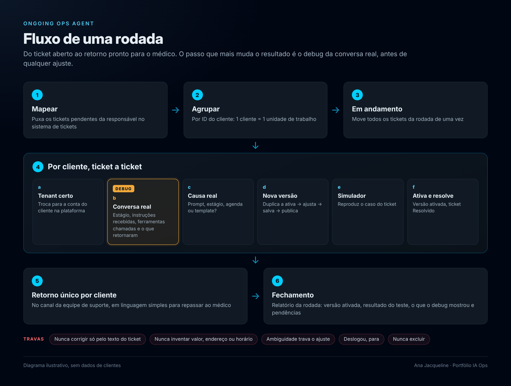

# Portfólio · IA aplicada a operações

Projetos de **AI Ops** em uma operação de secretárias virtuais de IA no WhatsApp para clínicas médicas: agentes que atendem pacientes, tiram dúvidas e marcam consultas. Os três projetos cobrem o ciclo inteiro de um agente em produção: como ele é **construído** de forma padronizada, como é **implantado** e acompanhado, e como é **mantido** quando os pedidos de ajuste chegam.

> Todos os exemplos usam dados fictícios ou anonimizados. Nenhum nome de cliente, médico ou paciente real aparece neste repositório.



---

## Projetos

| Projeto | O problema | Tecnologias |
|---|---|---|
| [**Padronização de agentes de IA no WhatsApp**](padronizacao-agentes-whatsapp/) | Cada agente era um prompt artesanal, com comportamento imprevisível entre clínicas e manutenção cara | Prompt engineering, simulação controlada, debug de JSON turno a turno, pipeline Node de documentação |
| [**Painel de Onboarding**](painel-onboarding/) | O CRM mostrava só a foto do momento, sem histórico nem indicadores por dupla | Google Sheets, Apps Script, HTML/CSS/JS, html2canvas |
| [**Ongoing Ops Agent**](ongoing-ops-agent/) | Tickets de ajuste tratados à mão, de forma lenta e inconsistente | Agentes LLM, MCP, automação de navegador, tarefas agendadas |

## Resultados em números

| Indicador | Resultado |
|---|---|
| SLA de atendimento dos tickets de ajuste | de **~6h** para **~2h** (−67%), com fila média de 170 tickets abertos |
| Fila de atenção da equipe | de **71%** para **25%** de disparo, só com pedidos reais de trabalho |
| Implantação de um agente novo | de escrever um prompt para preencher **17 slots** |
| Documentação de implantação | **21 documentos** gerados de uma fonte única, para 3 modelos de agente |

## O fio condutor

Os três projetos seguem as mesmas ideias:

- **Fonte única de verdade.** Dado duplicado é dado que vai divergir. Isso vale para o núcleo dos prompts, para os snapshots do painel e para o registro de cada rodada de tickets.
- **Diagnóstico antes de correção.** Ler o debug da conversa real, comparar snapshots e verificar invariantes antes de mexer em qualquer coisa.
- **Falhar alto.** Patch que não encontra a âncora para a geração; número que não fecha aparece em vermelho; plataforma que desloga interrompe a rodada.
- **Humano no ponto certo.** A IA publica, testa e prepara o retorno, mas ativação em conversa real, ambiguidade e dado ausente passam por uma pessoa.

## Estrutura

```
portfolio-ia-ops/
├── padronizacao-agentes-whatsapp/   estudo de caso + diagramas
├── painel-onboarding/               código completo (src, docs, assets)
└── ongoing-ops-agent/               estudo de caso + diagramas
```

Os diagramas dos estudos de caso foram desenhados em HTML e CSS. As fontes ficam em `assets/fonte/` de cada projeto, para quem quiser editar e exportar de novo.

## Contato

**Ana Jacqueline** 

- LinkedIn: [linkedin.com/in/ajacqueline](https://www.linkedin.com/in/ajacqueline)
- E-mail: [anajacquelinejesus@gmail.com](mailto:anajacquelinejesus@gmail.com)
