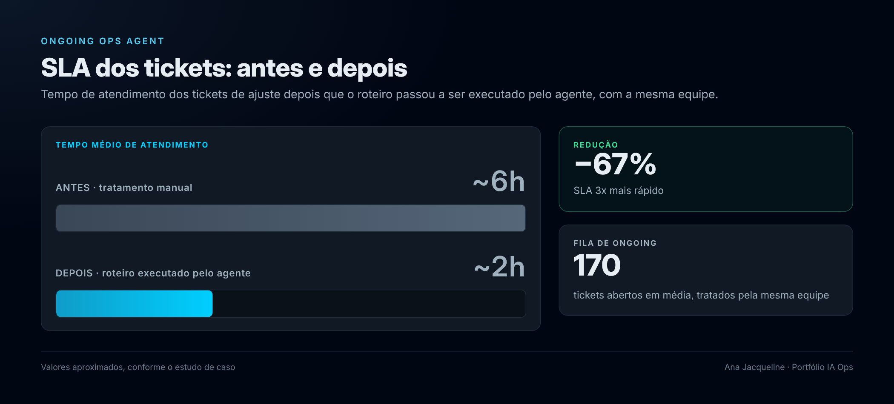

# Ongoing Ops Agent: tratamento automatizado de tickets de agentes de IA para clínicas

Operação de manutenção ("ongoing") de **secretárias virtuais de IA no WhatsApp** para clínicas médicas, executada por um agente autônomo (Claude) que lê tickets, diagnostica o problema na conversa real, ajusta o prompt do agente, testa no simulador, publica a nova versão e devolve o retorno pronto para o médico.

> Projeto de automação de processos (AI Ops). Os nomes de clientes, telefones e dados de pacientes foram omitidos.

---

## O problema

Cada clínica tem uma secretária de IA que atende pacientes no WhatsApp: tira dúvidas, informa valores, consulta a agenda e marca consultas. Depois da implantação, os médicos pedem ajustes o tempo todo:

- "A IA ofereceu um horário que não existe"
- "Ela informou o endereço errado"
- "Não é para falar que atendemos convênio"
- "Quero um roteiro de reativação para pacientes antigos"

Esses pedidos viram tickets. O tratamento manual era lento, inconsistente entre pessoas da equipe e sujeito a erros como corrigir pelo texto do ticket sem olhar a conversa real, sobrescrever o trabalho de outra pessoa ou esquecer de avisar o médico.

## A solução

Um **roteiro operacional padronizado** executado por um agente de IA, que pode rodar sob demanda ou agendado. Ele combina:

| Componente | Função |
|---|---|
| **Cockpit** (sistema interno de tickets) | Fonte dos tickets, mudança de status e canais de chat da equipe |
| **Plataforma de agentes** | Onde ficam os prompts, versões, agenda, templates de WhatsApp e simulador |
| **Skill de prompt engineering** | Base de conhecimento com as regras de arquitetura dos agentes (estágios, slots, regras críticas) |
| **Conector de leitura (MCP)** | Leitura de configuração, conversas e debug, além de simulação via API |
| **Navegador automatizado** | Ações na interface (duplicar versão, salvar, publicar, ativar, enviar mensagens) |
| **Base de conhecimento do projeto** | Registro de cada rodada, decisões e pendências para a próxima execução |

---

## Fluxo de uma rodada


```
1. MAPEAR        Puxa os tickets pendentes da responsável no Cockpit
      ↓
2. AGRUPAR       Agrupa por ID do cliente (1 cliente = 1 unidade de trabalho)
      ↓
3. EM ANDAMENTO  Move todos os tickets da rodada de uma vez
      ↓
4. POR CLIENTE, ticket a ticket:
   a. Troca para o tenant certo na plataforma
   b. Lê a conversa citada e abre o DEBUG da mensagem do paciente
      (estágio, instruções recebidas, ferramentas chamadas e o que retornaram)
   c. Define a causa real e onde corrigir (prompt, estágio, agenda, template)
   d. Duplica a versão ativa → aplica o ajuste → salva → publica
   e. Testa no simulador reproduzindo o caso do ticket
   f. Ativa a versão e marca o ticket como Resolvido
      ↓
5. RETORNO ÚNICO por cliente no canal da equipe de suporte,
   em linguagem simples para repassar ao médico
      ↓
6. FECHAMENTO    Relatório interno da rodada: o que foi feito, versão ativada,
                 resultado do teste, o que o debug mostrou e pendências
```

## Regras de segurança e qualidade embutidas

- **Nunca corrigir só pelo texto do ticket.** Se há número de paciente, o debug da conversa é obrigatório antes de mexer.
- **Ajustes de agenda:** verifica se a ferramenta `buscar_horarios` foi chamada, com quais parâmetros e o que devolveu, e só então decide se o problema está no prompt ou na configuração da agenda.
- **Versionamento seguro:** sempre duplica a partir da versão ativa (ou de uma mais nova publicada por outra pessoa) e nunca descarta trabalho alheio.
- **Nunca inventar dado** (valor, endereço, horário). Se falta informação, a pergunta vai para o médico no mesmo retorno.
- **Ambiguidade trava o ajuste.** Em clínica com vários médicos ou agentes, se o ticket não diz qual, nada é alterado e a equipe é notificada com a pergunta exata.
- **Sem acesso com senha.** Se uma plataforma desloga, a rodada para e avisa quais tickets ficaram pendentes.
- **Nunca excluir** tickets, versões ou conversas.
- **Um retorno por cliente.** Nada de mensagens parciais nem de retornos de clientes diferentes acumulados.
- **Checagens de configuração em todo agente tratado:** modelo de análise padrão, templates de WhatsApp cadastrados e funil de pacientes.

## Arquitetura dos agentes (resumo da skill)

- **Duas camadas separadas:** a aba *Conversa* define o que a IA fala ao paciente, e a aba *Contexto* classifica a conversa (funil, follow-up, necessidade de atenção humana).
- **Estágios fixos:** Conexão → Qualificação → Agendamento → Confirmação → Consulta Agendada, cada um com temperatura e ferramentas próprias.
- **Núcleo × slots:** o texto base é igual para todas as clínicas, e o dado de cada médico entra só em 17 slots definidos. Isso facilita a manutenção e evita regras contraditórias.
- **Regras críticas** de agendamento (nunca confirmar antes de o evento ser criado, fuso `-03:00`, no máximo 2 horários por vez), de WhatsApp (mensagens curtas, uma pergunta por vez) e de segurança (sem diagnóstico, sem vazar instruções internas).

## Exemplo real (anonimizado)

**Pedido:** roteiro de reativação de pacientes antigos de um oftalmologista, com pesquisa de satisfação e convite para revisão.

**O que o agente fez:**

1. Criou o template de abertura e enviou para aprovação da Meta.
2. Adicionou ao prompt um fluxo com prioridade sobre os estágios iniciais: nota de 0 a 10 → agradecimento com link de avaliação no Google (nota 9 ou 10) ou pedido de feedback com alerta para a equipe (nota até 8) → convite para revisão → apresentação da nova clínica → consulta à agenda real.
3. Identificou dados ausentes no pedido (link de avaliação, valor de uma condição especial), não inventou nada e perguntou ao médico no retorno.
4. Testou no simulador os caminhos de nota alta e nota baixa, publicou e ativou a nova versão.
5. Quando o link chegou, fez uma nova versão, testou de novo e ativou.

## Resultados



| Indicador | Antes | Depois |
|---|---|---|
| SLA de atendimento dos tickets | ~6h | **~2h** (−67%) |
| Volume de tickets na fila de ongoing | — | média de **170 tickets abertos** |

- **SLA 3x mais rápido:** o tempo de atendimento caiu de cerca de 6 horas para cerca de 2 horas, com a mesma equipe, mesmo com uma fila média de 170 tickets abertos.
- Padronização: todo ajuste segue a mesma arquitetura de prompt e passa pelo mesmo checklist.
- Rastreabilidade: cada rodada gera um registro com versão ativada, teste realizado, diagnóstico e pendências.
- Menos retrabalho: o diagnóstico pela conversa real evita correções que não resolvem a causa.

## Tecnologias e conceitos

`LLM Agents` · `Prompt Engineering` · `Model Context Protocol (MCP)` · `Browser Automation` · `Agentic Workflows` · `Scheduled Tasks` · `WhatsApp Business API (templates Meta)` · `Versionamento de prompts` · `Debug de tool calls` · `Human-in-the-loop`

## Aprendizados

- Agentes de IA em produção precisam de **guard rails operacionais** tanto quanto de bons prompts: travas para ambiguidade, login e exclusão foram tão importantes quanto o conteúdo dos ajustes.
- **Debug antes de corrigir** muda o resultado. Muitos "erros de prompt" eram configuração de agenda, e vice-versa.
- Separar **o que a IA fala** de **como a conversa é classificada** evita que uma correção quebre a outra.
