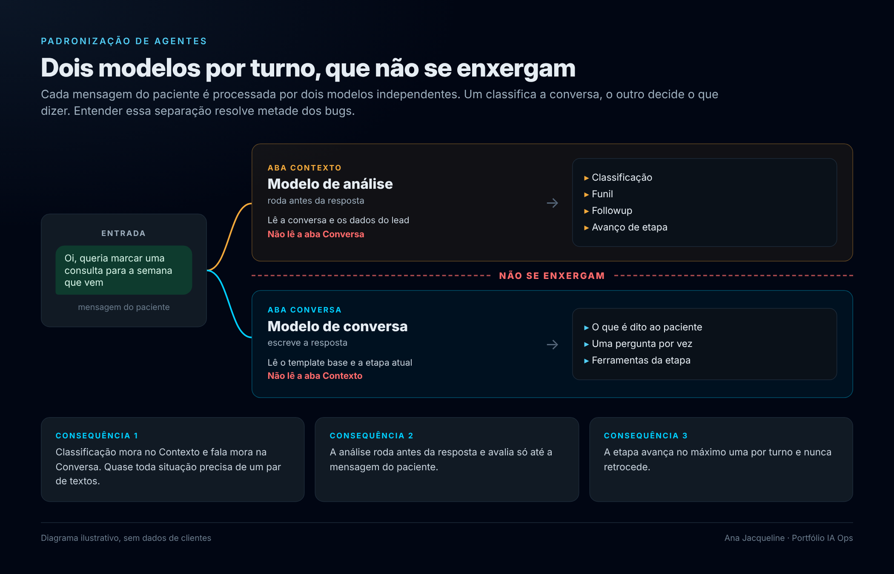
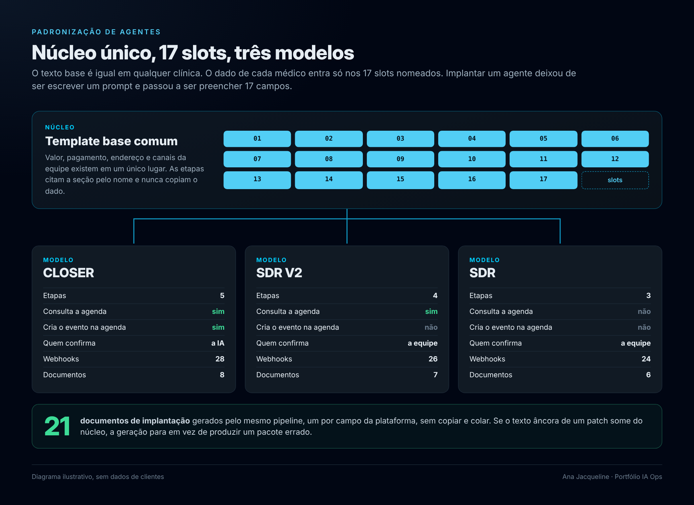
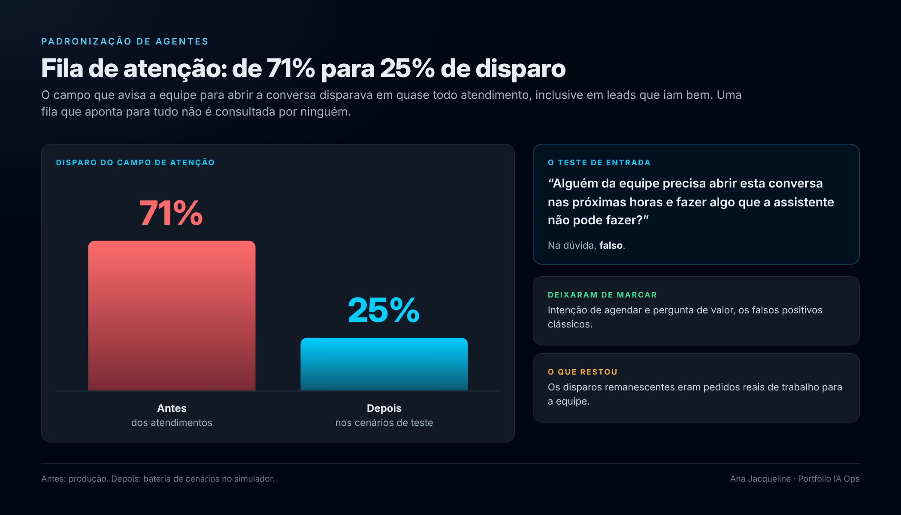

# Padronização de agentes de IA para agendamento médico no WhatsApp

Estudo de caso da reengenharia de agentes conversacionais que marcam consulta por WhatsApp em clínicas médicas. O trabalho saiu de prompts escritos um a um, cada agente com uma lógica própria, e chegou a um padrão único com 17 pontos de customização, três modelos de agente derivados do mesmo núcleo e um pipeline que gera a documentação de implantação a partir da fonte.

Os exemplos deste repositório usam uma clínica fictícia. Nenhum dado de cliente real aparece aqui.

---

## O problema

Cada agente era um prompt artesanal. Isso trazia três custos que só apareciam em produção.

Comportamento imprevisível entre contas: a mesma situação, um paciente pedindo para falar com uma pessoa, terminava classificada de três formas diferentes em três clínicas.

Fila de atenção inutilizável: o campo que avisa a equipe que alguém precisa abrir a conversa disparava em 71% dos atendimentos, inclusive em leads que estavam indo bem. Uma fila que aponta para tudo não é consultada por ninguém.

Manutenção cara: corrigir uma regra significava abrir dezenas de prompts e torcer para não esquecer nenhum. Dado repetido em dois lugares virava dado divergente na primeira atualização.

---

## O que analisamos

Três frentes, nesta ordem.

**Leitura comparada de agentes em produção.** Mapeamos as versões mais recentes de três agentes ativos, campo a campo, incluindo um com integração de prontuário. O diagnóstico separou três causas distintas para o mesmo sintoma: num deles a lista correta de gatilhos estava na aba errada, invisível para o modelo que decide; noutro o primeiro item da lista marcava todo lead bom; no terceiro gatilhos de registro de estado conviviam com pedidos reais de trabalho.

**Simulação controlada.** Rodamos 14 cenários no simulador da plataforma, sem tocar em conversa real: recusa, objeção de preço, número errado, pedido de prompt interno, cancelamento, urgência clínica, despedida seguida de "obrigada, tchau". Cada rodada registrou os campos de saída da análise para comparar antes e depois.

**Leitura de debug turno a turno.** Para os bugs que não reproduziam no simulador, lemos o JSON de processamento de cada mensagem, o que o modelo de análise recebeu e o que devolveu. Foi assim que achamos as duas causas-raiz mais caras, descritas abaixo.

---

## Achados que viraram regra

| Achado | Causa | Correção |
|---|---|---|
| Conversa agendava e ficava parada na etapa anterior | O objetivo da etapa de Agendamento continha "criar o agendamento", então a análise segurava a conversa esperando um evento que aquela etapa não cria | A palavra passou a existir num único lugar do sistema, o objetivo da etapa de Confirmação |
| Etapa pulada quando o paciente respondia uma só vez | A plataforma avança no máximo uma etapa por turno, e a IA confirmava o horário e pedia os dados na mesma mensagem | A mensagem que registra a escolha encerra o turno; a coleta de dados é do turno seguinte |
| Fila de atenção com 71% de disparo | O campo era usado como registro do que aconteceu, não como pedido de trabalho | Teste de entrada explícito no prompt: alguém da equipe precisa abrir esta conversa nas próximas horas e fazer algo que a assistente não pode fazer? Na dúvida, falso |
| Lead marcado como perdido sem ter se recusado | Campos booleanos negativos adjacentes arrastavam o valor do campo seguinte, efeito da geração autorregressiva | Campos de herança B2B desligados, ordem fixa dos campos e uma âncora de raciocínio que obriga a citar a evidência antes da decisão |
| Dois contatos para a mesma pessoa | A IA avisava que ia acionar a equipe e, em paralelo, programava retomada automática | Encaminhamento desliga o followup no mesmo turno e o religa se o paciente voltar com algo que a assistente resolve sozinha |
| Loop de despedidas | O prompt não tinha regra para não responder, e qualquer tentativa de instruir silêncio vazava a palavra para o paciente | Seção dedicada com fallback literal e proibição explícita de marcadores de estado |

---

## A arquitetura



Dois modelos de linguagem rodam por turno e **não se enxergam**. Entender isso é o que resolve metade dos bugs.

```
mensagem do paciente
        │
        ├──► ABA CONTEXTO (modelo de análise) ──► classificação, funil, followup, avanço
        │     lê a conversa + dados do lead          NÃO lê a aba Conversa
        │
        └──► ABA CONVERSA (modelo de conversa) ──► o que é dito ao paciente
              lê o template base + a etapa atual     NÃO lê a aba Contexto
```

Três consequências que governam todo o padrão: classificação mora no Contexto e fala mora na Conversa, então quase toda situação precisa de um par de textos diferentes; a análise roda antes da resposta e avalia só até a mensagem do paciente; e a etapa avança no máximo uma por turno e nunca retrocede.

### Núcleo e slots



Todo o texto é núcleo, idêntico em qualquer clínica, exceto **17 slots** nomeados. Implantar um agente virou preencher 17 campos, não escrever um prompt. Valor, pagamento, endereço, canais da equipe e dados cadastrais existem em um único lugar; as etapas referenciam a seção pelo nome e nunca copiam o dado.

### Três modelos, mesmo núcleo

| | CLOSER | SDR V2 | SDR |
|---|---|---|---|
| Etapas | 5 | 4 | 3 |
| Cria o evento na agenda | sim | não | não |
| Consulta a agenda | sim | sim | não |
| Quem confirma | a IA | a equipe | a equipe |
| Webhooks | 28 | 26 | 24 |

Os nomes das etapas e as temperaturas são fixos nos três. O que muda é quantas etapas existem e o objetivo das duas últimas.

---

## Como automatizamos

**Operação da plataforma via API.** As versões de agente passaram a ser criadas, lidas e publicadas por chamadas diretas à API do painel, a partir da sessão autenticada do navegador. Isso tornou possível clonar a configuração completa de uma versão, aplicar uma correção cirúrgica em dois campos de prompt e publicar uma versão nova sem reabrir 24 modais na interface. A ativação continua sendo um clique humano, de propósito: publicar é reversível, ativar mexe em conversa real.

**Diff por seção.** Para comparar o que está publicado com a fonte local sem baixar 30 mil caracteres a cada conferência, o template base é quebrado nos seus separadores de seção e comparado por tamanho normalizado e hash. Só a seção que divergiu é lida por inteiro.

**Bateria de simulação.** Cada versão nova roda a mesma lista de cenários no simulador, criando um lead por cenário e lendo os campos de saída da análise ao fim. O critério de aceite é numérico, por exemplo no máximo dois disparos de atenção em oito cenários, e os dois precisam ser legítimos.

**Geração da documentação de implantação.** A fonte de verdade é markdown versionado. Um script aplica as diferenças de cada modelo sobre o núcleo, com substituições explícitas que falham alto se o texto âncora não existir mais, e um conversor próprio em Node transforma cada arquivo no documento final, preservando bloco de código em fonte monoespaçada, tabelas com largura fixa e tipografia consistente. De uma fonte saem três pacotes, 21 documentos, sem copiar e colar.

```
fonte markdown (núcleo)
   └─ patch por modelo  ──►  CLOSER · SDR V2 · SDR
          └─ conversor  ──►  documentos de implantação (um por campo da plataforma)
```

A escolha de falhar alto importa: quando uma frase do núcleo muda e o patch não encontra mais a âncora, a geração para em vez de produzir silenciosamente um pacote errado.

---

## Resultados



A fila de atenção caiu de 71% para 25% de disparo nos cenários de teste, e os dois casos remanescentes eram pedidos reais de trabalho. Os falsos positivos clássicos, intenção de agendar e pergunta de valor, deixaram de marcar. O avanço até a última etapa voltou a acontecer. A recusa temporária deixou de virar lead perdido, porque passou a exigir citação literal do paciente e despedida já enviada. E a implantação de um agente novo deixou de ser redação para virar preenchimento de 17 campos, com a documentação saindo pronta do mesmo pipeline.

---

## O que eu levaria para qualquer projeto parecido

O comportamento do modelo depende da **ordem** dos campos que ele escreve, não só do texto de cada um. Campos negativos adjacentes se alinham entre si, e uma justificativa escrita imediatamente antes da decisão melhora a decisão.

Instrução semântica não executa: pedir no prompt de conversa que a IA marque um campo não marca campo nenhum, porque quem escreve aquele campo é outro modelo, que não lê aquele prompt.

Dado duplicado é dado que vai divergir. A regra de existir num único lugar vale mais que a conveniência de ter o valor à mão dentro da etapa.

E o teste que salva uma fila de trabalho é sempre o mesmo: isto é um pedido de ação para um humano, ou é só um registro de que algo aconteceu?

---

## Estrutura do pacote de implantação

```
CLOSER/                      SDR V2/                      SDR/
 01 Template Base             01 Template Base             01 Template Base
 02 Etapa 1 Conexão           02 Etapa 1 Conexão           02 Etapa 1 Conexão
 03 Etapa 2 Qualificação      03 Etapa 2 Qualificação      03 Etapa 2 Qualificação
 04 Etapa 3 Agendamento       04 Etapa 3 Agendamento       04 Etapa 3 Agendamento
 05 Etapa 4 Confirmação       05 Etapa 4 Confirmação       05 Template de Followup
 06 Etapa 5 Consulta Agendada 06 Template de Followup      06 Aba Contexto
 07 Template de Followup      07 Aba Contexto
 08 Aba Contexto
```

Cada documento corresponde a um campo da plataforma e contém apenas o texto que vai colado, com os slots marcados.
