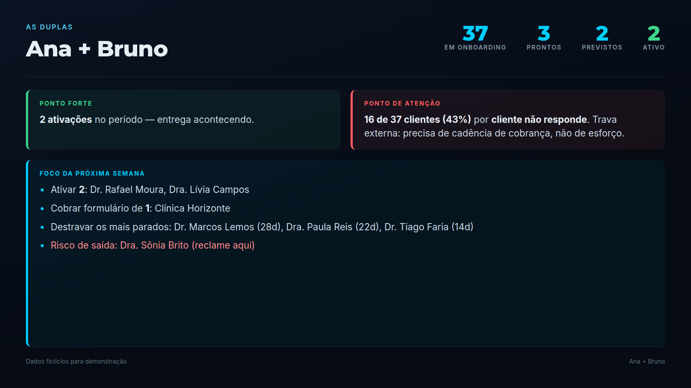
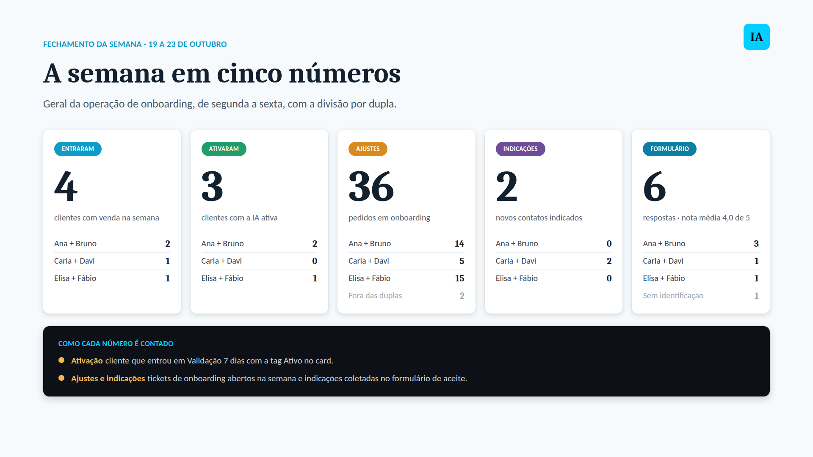
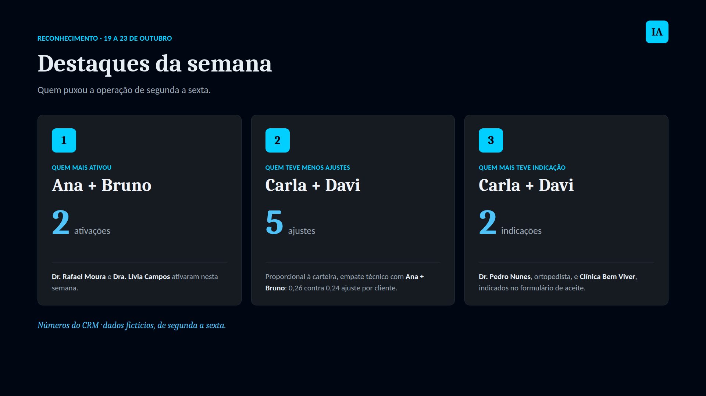
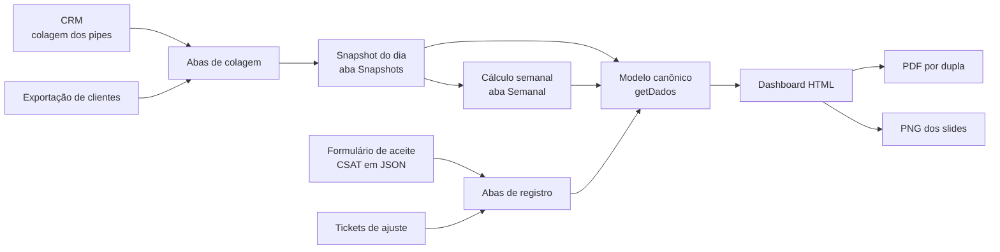

# Painel de Onboarding · acompanhamento semanal das duplas

Painel construído em **Google Sheets + Apps Script** para acompanhar, semana a semana, a implantação de agentes de IA de atendimento em clínicas médicas. Ele transforma a colagem do CRM, que é só uma foto do momento, em histórico, indicadores por dupla, metas do time e material pronto para reunião: PDF de planejamento e slides em PNG.

> Todos os nomes de pessoas, clientes e duplas deste repositório são **fictícios**. O código é o que roda em produção, com os dados reais trocados.



## O problema

O time de onboarding trabalha em duplas, um Concierge e um Gestor de IA, e cada cliente passa por dois pipes no CRM. O CRM mostra onde cada card está **agora**, mas não responde as perguntas que a liderança faz toda semana:

- Quantos clientes ativaram nesta semana, e de qual dupla?
- Quem está parado, e parado por quê: trava do cliente ou fila nossa?
- Qual dupla está entregando, e qual precisa de ajuda?
- Estamos batendo as metas do piloto: CSAT, ajustes, indicações?

Antes do painel, essas respostas saíam de contagem manual e cada pessoa contava de um jeito.

## O que o painel entrega

**Leitura da operação.** Carteira de onboarding em níveis, funil de conversão entre etapas, motivo de espera de cada cliente, ADM de contratos, cancelamentos por fase e ativações do mês.

**Leitura por dupla.** Carteira, prontos, previstos, ativados, ponto forte e ponto de atenção gerados a partir dos números, e um foco da semana com nomes: quem ativar, quem cobrar e quem destravar.

**Metas do piloto.** CSAT da ativação, com taxa de resposta, nota média e detratores, controle de ajustes pós-ativação por cohort mensal e placar de indicações.

**Material de reunião.** PDF de planejamento semanal por dupla, com caixinha de "feito", e slides em PNG, gerados por botão no próprio painel.

| Fechamento da semana | Reconhecimento |
|---|---|
|  |  |

## Como funciona



A ideia central: **colagem é foto, snapshot é filme.** Toda sexta o time cola os pipes, o script grava um snapshot datado, e é a comparação entre snapshots que mostra quem andou, quem ativou e quem ficou parado. Sem histórico, só existe estoque.

Detalhes em [docs/arquitetura.md](docs/arquitetura.md) e regras de cálculo em [docs/regras-de-negocio.md](docs/regras-de-negocio.md).

## Decisões que fizeram diferença

Alguns pontos que pareciam detalhe e mudavam o número inteiro. A história completa está em [docs/historico.md](docs/historico.md).

- **Contar cliente, não card.** O mesmo cliente tem card em dois pipes. Contar card dobrava ativações e fazia a conta de carteira não fechar.
- **Ativação é a entrada em Validação, com a tag Ativo.** A passagem para Ongoing é fim de acompanhamento, não entrega nova. Misturar os dois inflava a semana de quem só arrumou carteira antiga.
- **A data real vem dos "dias na etapa".** O snapshot só vê o cliente no dia da leitura. Descontar os dias na etapa dá o dia exato em que ele entrou.
- **Tag lida só da coluna de tags.** A coluna Status do CRM tem o valor "Ativo", que também virou nome de tag. Ler as duas juntas criava 45 ativações que não existiam.
- **Classificação por palavra-chave, não por frase exata.** Tag escrita de outro jeito no CRM deixou de derrubar a classificação.
- **Verificações internas.** O modelo tem invariantes, por exemplo "adm + onboarding + ativados = base". Se algum não fecha, o painel avisa em vermelho antes de alguém levar o número para reunião.

## Estrutura

```
src/
  Codigo.gs        parser da colagem, snapshots, cálculo semanal, modelo e metas
  Dashboard.html   painel: modos Apresentação, Completo e Metas Onboarding
  PdfDuplas.gs     PDF de planejamento semanal por dupla
  SlideDuplas.gs   grava no Drive os PNGs desenhados pelo painel
docs/
  arquitetura.md
  regras-de-negocio.md
  historico.md
  instalacao.md
assets/            imagens com dados fictícios
```

## Stack

Google Sheets como base de dados, Google Apps Script no servidor, HtmlService com HTML, CSS e JavaScript puros no painel, html2canvas para os PNGs, conversor nativo do Apps Script para os PDFs e Google Drive para guardar os arquivos. Desenvolvido com o Claude, da Anthropic, como par de programação e de análise.

## Instalação

Passo a passo em [docs/instalacao.md](docs/instalacao.md).

## Autoria

Ana Jacqueline · Tech Lead.
